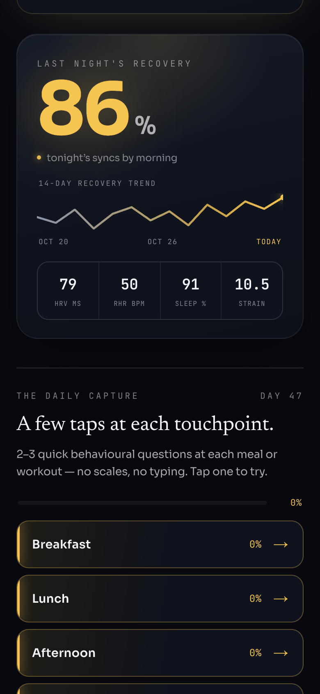
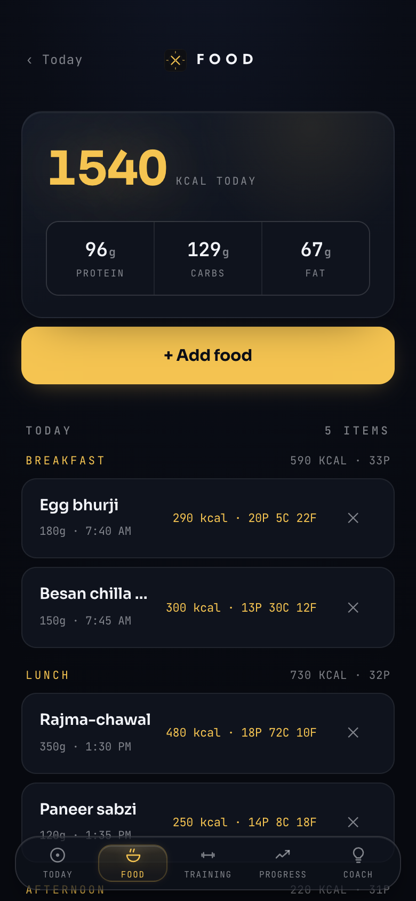
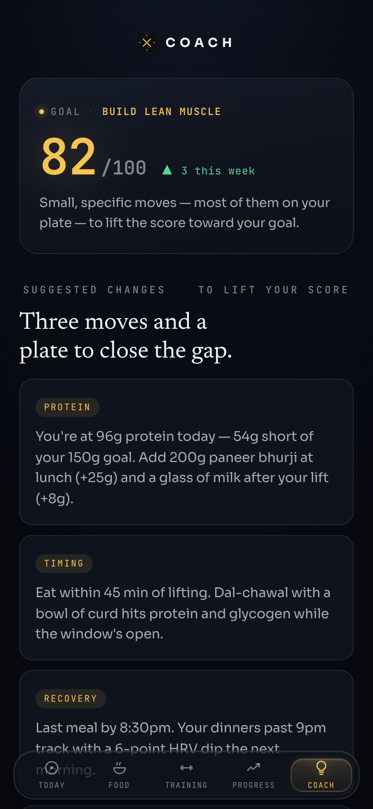

# Calibex

**One instrument for your whole self.** Calibex joins what you eat, how you train, how you sleep and how you feel to your WHOOP data, then finds what actually moves your recovery, and tells you when it doesn't know yet.

**Live demo:** https://calibex-demo.vercel.app (sample data)

<p>
  
  
  
</p>

## Why

Your recovery is trapped in a wearable. Your meals are in a food app. Your training is in a third. Your stress and mood are nowhere, or in your memory, which lies. So the questions that matter can't be answered:

- Which foods move my recovery, and how many days later?
- What does alcohol really cost across the next four days, not just tomorrow?
- Does a hard training block quietly raise my stress floor?
- Does my mood wreck my sleep, or is it the other way round?

Calibex started after about 250 days of WHOOP journaling ended in burnout. Two things broke: logging was a separate chore every day, forever, and the insights were simple correlations that couldn't tell the alcohol from the late dinner from the hard session. Calibex fixes both.

## What it captures

| Domain | How |
|---|---|
| **Food** | Snap or type a meal; it's matched to real product labels for calories, macros, fibre and sugar |
| **Training** | Sessions, lifts and how hard they felt, plus WHOOP workouts and strain |
| **Sleep** | WHOOP sleep, plus naps and how rested you woke |
| **Substances** | Alcohol (what and how much) and caffeine |
| **Mood and stress** | Quick yes/no questions, never 1–10 ratings |
| **Body** | WHOOP HRV, recovery, resting heart rate and strain, synced automatically |

**The questions are concrete,** so they can be measured cleanly. A pool of 40, for example:

- *Snap at or feel short with someone?*
- *Tension headache, or catch yourself clenching your jaw, today?*
- *Still groggy or foggy an hour after waking?*
- *Give in to a strong craving today?*

## How it works

1. **Logging fits moments you already have.** A meal, a workout, bedtime. Each touchpoint shows about 3 questions sampled from the pool, so it stays fresh and takes under two minutes a day. No streaks, no guilt. A skipped entry is just missing data.
2. **Everything lines up on one day.** Food, training, mood and WHOOP join on the wake date, so last night's dinner sits next to this morning's recovery.
3. **Your baseline, not a generic one.** Effects are measured as change from your own rolling normal.
4. **Honest statistics.** Daily health data is autocorrelated: 60 logged days is closer to 20 independent points. Calibex works out the real sample size and gates every insight. Below the bar, it says *"not enough signal yet"* out loud.
5. **Scores are computed, never stored.** Data stays item-level, so the scoring model can improve without rewriting history.

The first two things it tests: **dinner timing → next-morning HRV**, and **alcohol → the multi-day recovery curve**.

## Status

In daily use by one person. It's collecting 60 days of data before the correlation engine switches on.

## Privacy

Built for a single owner. Every table is locked to the owner's login with row-level security, sign-ups are off, and the database keys never reach the browser except the public one. Test fixtures in this repo are synthetic.

## Stack

- **App:** Next.js 16, React 19 and TypeScript; an installable web app with push reminders (`web/`), on Vercel
- **Database and sign-in:** Supabase (Postgres, email one-time code, row-level security)
- **WHOOP sync:** Python scripts plus a signed WHOOP webhook
- **Food reading:** Anthropic API for meals, drinks and supplements

Deeper reading: [the thesis](CALIBEX_THESIS.md) · [statistics rules](CORRELATION_RULES.md) · [instrument design](INSTRUMENT_DESIGN.md) · [question sampler](SAMPLER_SPEC.md) · [readout](READOUT_SPEC.md)

## Tests

263 tests covering the statistics, body clock, food reader and question sampler.

```bash
cd web && npm test
cd web && npx tsc --noEmit && npm run build
python3 -m unittest tests/test_wake_date.py
```

## Run your own copy

Calibex is single-user, so each person runs their own copy: their own Supabase project, WHOOP developer app and Vercel deploy. **The repo is not a one-step installer yet.** Some tables and the `private` schema come from database migrations not included here, so treat the SQL as a reference for the data model.

<details>
<summary>Setup notes</summary>

Env var names only; see `.env.example` for where each one goes.

1. **Database.** Run `schema.sql`, `calibex_v2_schema.sql`, `calibex_v2_seed.sql`, then the numbered migrations in order. Not included: migrations 001–002, the `private` schema (`private.is_owner()` and the reminder functions), the tables `food_log`, `foods`, `lift_log`, `lift_templates`, `meal_skips`, `push_subscriptions`, `saved_meals` and `exercise_favorites`, and the `push_status` function. In `008_owner_rls.sql` replace `you@example.com` with your sign-in email. Turn off sign-ups and anonymous sign-ins in Supabase Auth after your first sign-in.
2. **App.** `cd web && npm install && npm run dev`. Needs `NEXT_PUBLIC_SUPABASE_URL`, `NEXT_PUBLIC_SUPABASE_ANON_KEY` and `ANTHROPIC_API_KEY`. For push and sync, also `NEXT_PUBLIC_VAPID_PUBLIC_KEY`, `NUDGE_SECRET`, `WHOOP_CLIENT_SECRET`, `GITHUB_DISPATCH_TOKEN` and `GITHUB_REPO`.
3. **WHOOP.** Register an app at developer.whoop.com and set `WHOOP_CLIENT_ID`, `WHOOP_CLIENT_SECRET` and `WHOOP_REDIRECT_URI`. Then `pip install -r requirements.txt` and run `python3 authorize_whoop.py` once.
4. **Scheduled jobs.** Sync and reminders run from the owner's private deployment, so no workflows are included. If you add your own, the secrets are `WHOOP_CLIENT_ID`, `WHOOP_CLIENT_SECRET`, `SUPABASE_URL`, `SUPABASE_ANON_KEY`, `VAPID_PUBLIC`, `VAPID_PRIVATE` and `VAPID_SUBJECT`. The secret named `SUPABASE_ANON_KEY` must hold the service-role key, because those jobs bypass row-level security. Keep it in Actions secrets, never in the browser.

</details>

## License

MIT
